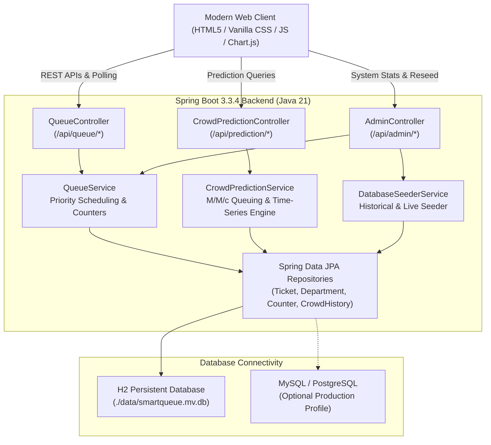

# Q-Flow AI: Smart Digital Queue & Crowd Prediction System

A full-stack, enterprise-grade **Smart Digital Queue Management & Crowd Influx Prediction System** built with **Java 21**, **Spring Boot 3**, **Spring Data JPA**, persistent **Database Connectivity (H2 File-based / MySQL compatible)**, and an interactive **Glassmorphic Web Dashboard**.

---

## 🌟 Key System Capabilities

### 1. 🎫 Self-Service Digital Kiosk
- Multi-department token issuance (`ACC` - Cash & Accounts, `LON` - Loans & Mortgages, `CIT` - Citizen KYC, `SUP` - Support & Grievances).
- Multi-tier priority routing (**Regular**, **Senior Citizen / Specially-Abled**, and **VIP / Fast Track**).
- Real-time estimated waiting time calculation using queue depth and active counter throughput.
- Digital token receipt with simulated QR code and direct live tracking.

### 2. 📺 Public Queue Display Board (TV / Large Screen Monitor)
- High-visibility airport/hospital-style announcement screen.
- Animated **"NOW CALLING"** Hero banner with counter flashing effect.
- **Web Speech API & Audio Chime**: Speaks real-time voice announcements (e.g. *"Token CIT-004, please proceed to Counter 05"*).
- Grid of active counters showing current customer, status badges (`AVAILABLE`, `BUSY`, `ON_BREAK`, `OFFLINE`).
- Upcoming queue preview and department load distribution.

### 3. 👨‍💼 Counter Operator Workstation
- Multi-counter switcher (Counter 01 to Counter 06).
- Live service stopwatch timer measuring average handling time (AHT).
- Operational controls: **Call Next Customer**, **Recall / Audio Chime**, **Complete Service**, **Mark No-Show**, and Counter status toggles.
- Real-time department waiting list with priority markers.

### 4. 🔍 Live Customer Ticket Tracker
- Real-time progress timeline (Issued ➔ In Queue ➔ Called to Counter ➔ Completed).
- Live counter of remaining people ahead and dynamically updated wait times.

### 5. 📈 AI Crowd Prediction & Congestion Forecaster
- **M/M/c Multi-Server Queuing Model** + **Exponential Smoothing** with Day-of-Week & Hourly Seasonal Factors.
- **24-Hour Crowd Influx Curve**: Predicts hourly footfall volume across operating hours (9:00 AM – 6:00 PM).
- **Wait Time Progression Model**: Estimates wait times under varying arrival rates.
- **Counter Staffing Advisor**: Recommends the optimal number of active counters to keep customer wait times under 12 minutes.
- **"Best Time to Visit" Recommender**: Highlights the least congested arrival windows for customers.
- **Weekly Volume Heatmap**: Compares Monday rush, midweek stabilization, and weekend footfalls.

### 6. 🗄️ Database Connectivity & Persistence
- Built-in persistent **H2 Database Engine** (`./data/smartqueue.mv.db`) with zero setup needed out of the box.
- Integrated **H2 Web Console** at `http://localhost:8080/h2-console` for direct SQL queries and schema inspection.
- Auto-seeding on first boot: Seeds 4 departments, 6 service counters, 30 days of historical hourly crowd records (1,120 data points), and active live tickets.
- Ready for production **MySQL / PostgreSQL** switching via `application.properties`.

---

## 🏗️ Architecture Overview



---

## 🚀 How to Run the Project

### Prerequisites
- **Java 21** (`java -version`)
- **Apache Maven 3.9+** (`mvn -version`)

### Quick Start
1. Open a terminal in the project directory:
   ```bash
   cd c:\mentorconnectorPROJECT
   ```

2. Compile and run the Spring Boot application:
   ```bash
   mvn spring-boot:run
   ```

3. Open your browser and visit:
   - **Main Web Application:** [http://localhost:8080](http://localhost:8080)
   - **H2 Database SQL Console:** [http://localhost:8080/h2-console](http://localhost:8080/h2-console)
     - *JDBC URL:* `jdbc:h2:file:./data/smartqueue`
     - *User Name:* `sa`
     - *Password:* *(blank)*

---

## 📡 REST API Reference

| Endpoint | Method | Description |
| :--- | :---: | :--- |
| `/api/queue/ticket` | `POST` | Issue a new digital queue token with priority |
| `/api/queue/board` | `GET` | Get live public display board payload & last called ticket |
| `/api/queue/track/{tokenNumber}` | `GET` | Track personal ticket status, queue position & remaining wait |
| `/api/queue/counter/{id}/call-next` | `POST` | Counter operator calls the next customer in queue |
| `/api/queue/counter/{id}/recall` | `POST` | Re-announce customer and replay chime announcement |
| `/api/queue/counter/{id}/complete` | `POST` | Complete service for the current ticket |
| `/api/queue/counter/{id}/no-show` | `POST` | Mark current ticket as no-show / skipped |
| `/api/queue/counter/{id}/status` | `POST` | Change counter mode (`AVAILABLE`, `ON_BREAK`, `OFFLINE`) |
| `/api/queue/departments` | `GET` | List all service departments |
| `/api/queue/counters` | `GET` | List all service counters |
| `/api/queue/waiting` | `GET` | List currently waiting queue tickets |
| `/api/prediction/forecast` | `GET` | 24-hr crowd forecast, peak window, and best visit slots |
| `/api/prediction/day-trends` | `GET` | Historical day-of-week volume trends |
| `/api/admin/stats` | `GET` | System-wide queue metrics and counter status |
| `/api/admin/reseed` | `POST` | Reset and re-seed database with fresh demo data |

---

## 🗄️ Switching from H2 to MySQL

To connect to an external **MySQL** database instead of the embedded H2 file:

1. Open `src/main/resources/application.properties`.
2. Replace the datasource configuration with your MySQL credentials:
   ```properties
   spring.datasource.url=jdbc:mysql://localhost:3306/smartqueue_db?createDatabaseIfNotExist=true&useSSL=false&allowPublicKeyRetrieval=true
   spring.datasource.driverClassName=com.mysql.cj.jdbc.Driver
   spring.datasource.username=root
   spring.datasource.password=your_mysql_password
   spring.jpa.database-platform=org.hibernate.dialect.MySQLDialect
   spring.jpa.hibernate.ddl-auto=update
   ```
3. Restart the application: `mvn spring-boot:run`. Hibernate will automatically create all tables and index definitions.
